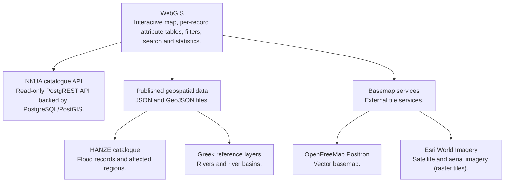

# Historic Floods: WebGIS

## Overview

An interactive WebGIS collection of peer-reviewed datasets of historic floods from around the world. The current flood catalogues are NKUA for Greece and HANZE for Europe. Greek rivers and river basins are available as geographic reference layers.

### Application architecture

Figure 1. Current application architecture.

## Number of records

Interactive Gaussian-kernel record density, from zero to the maximum, in records per 10,000 km². Smoothing distance is adjustable.

## Dates of records

Interactive map of distance-weighted mean recorded year. Colours span the earliest to latest year in the loaded catalogue.

## Dataset sources

Interactive map of HANZE and NKUA shares, calculated from their local kernel-weighted record contributions. Intermediate colours show overlap; unsupported locations remain blank.

The maps use the full loaded catalogue independently of the main filters. HANZE locations are administrative display points. They describe catalogue distributions rather than flood hazard or observed flood extents.

## Citation

Evelpidou, N., Karkani, E., Saitis, G., Spyrou, E., & Liaskos, A. (2026). *Historic Floods* [Interactive WebGIS]. National and Kapodistrian University of Athens. [historicfloods.org](https://historicfloods.org/).
